<div align="center">

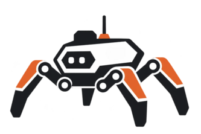

# Four Sight

**A semi-autonomous robot and a custom 3D-printed AR visor for finding people trapped under rubble**


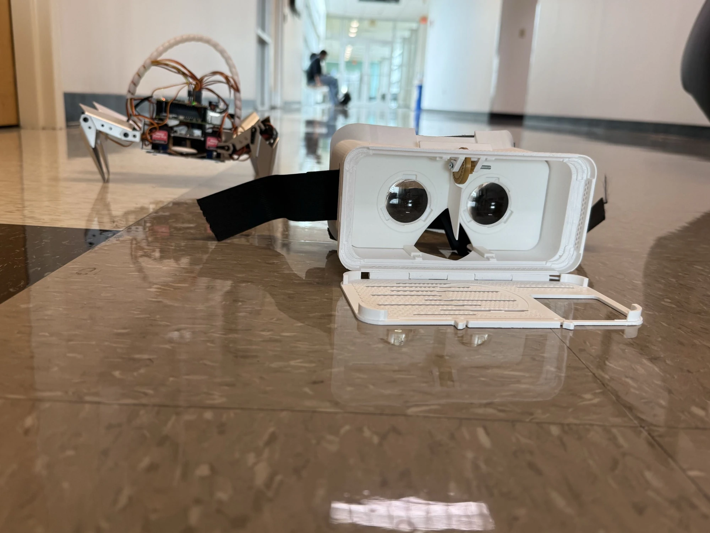

<sub><i>prada, our robot, and the visor we printed for it.</i></sub>

</div>

---

## The problem

After an earthquake, the people most likely to survive are the ones found in the first hours. Rubble is unstable, dark, and full of gaps no person can safely crawl into. Rescuers need eyes in those gaps, and they need them without giving up their hands.

## What we built

We built a semi-autonomous robot paired with a custom 3D-printed AR visor to help rescuers and aid workers find people trapped under the rubble.

A rescuer straps on the visor, puts on a glove controller, and taps in to a direct feed from the robot. **Tilting their head moves the camera. The joystick drives the robot** forward, backward, up, and down. YOLO26n-seg image segmentation picks out survivors in the camera feed, YOLO26n and SegFormer find open floor so the robot can explore on its own, and a Nemotron vision model describes survivors and hazards in each frame.

When the robot finds a survivor, the rescuer can **comfort them through a speaker and microphone on the robot** and **drop a beacon** at that location. Looking through the visor's front camera, the rescuer can see where they need to go.

The robots are meant to go out in **swarms** across an impacted area. A **Nemotron agent** takes voice commands from the rescuer, so they can keep the visor on and still attend to other duties. The agent puts survivors in critical condition first and keeps a queue of everyone who has been found.

<table>
  <tr>
    <td width="50%" align="center">
      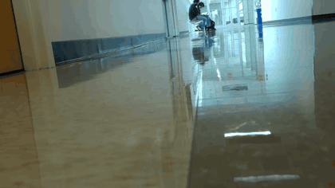<br>
      <sub><b>What prada sees.</b> Live from its camera while walking forward at half speed.</sub>
    </td>
    <td width="50%" align="center">
      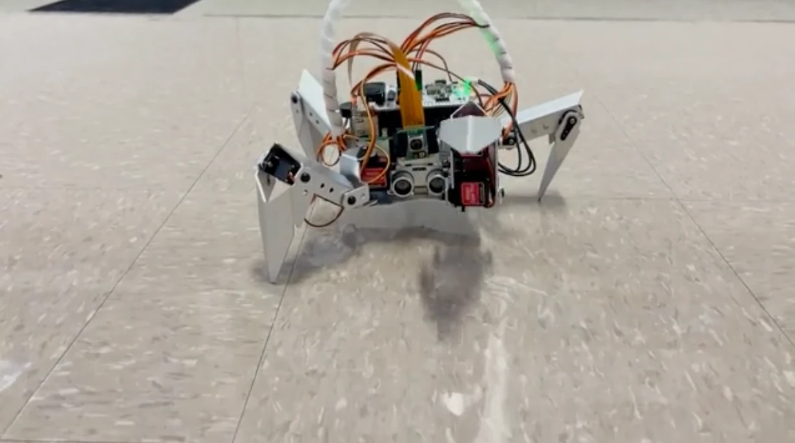<br>
      <sub><b>What prada looks like doing it.</b> A PiCrawler on a Raspberry Pi 5.</sub>
    </td>
  </tr>
</table>

## The hardware

<table>
  <tr>
    <td width="33%" align="center">
      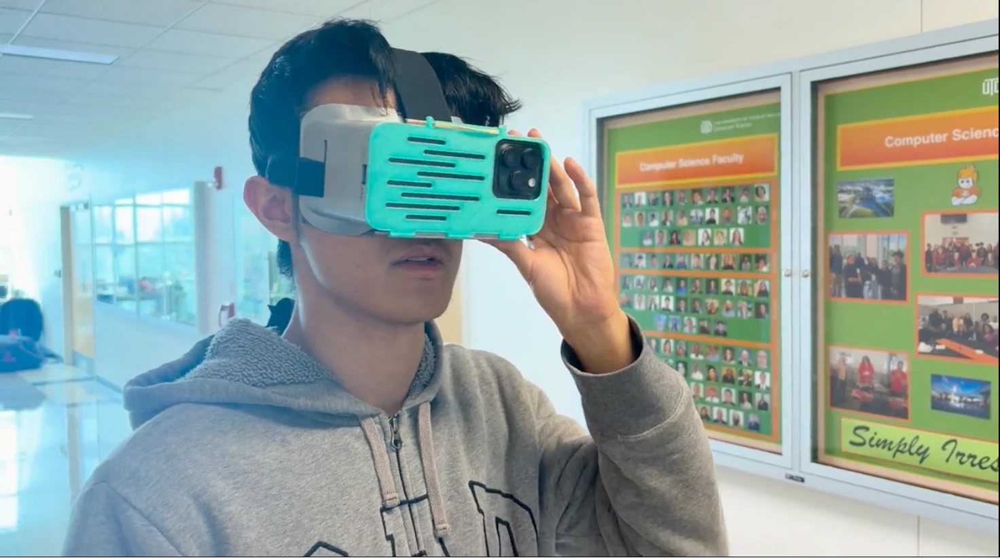<br>
      <sub><b>The visor.</b> 3D-printed shell, biconvex lenses, and an iPhone doing stereo video, segmentation, and head tracking.</sub>
    </td>
    <td width="33%" align="center">
      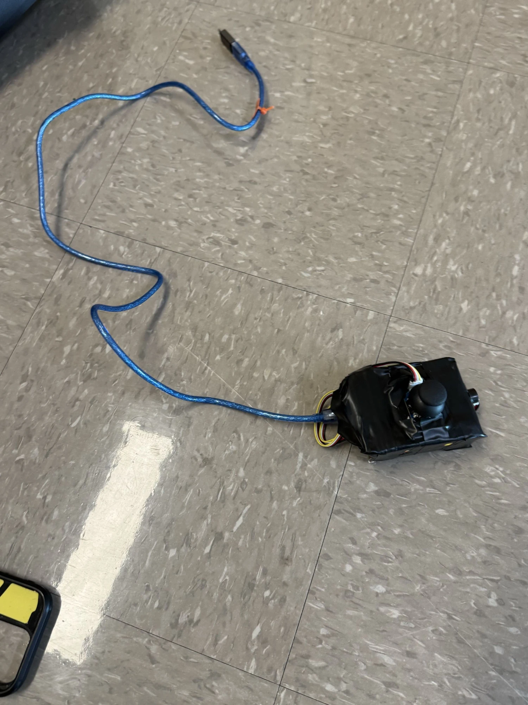<br>
      <sub><b>The controller.</b> A thumb joystick that drives prada while the rescuer's head aims the camera.</sub>
    </td>
    <td width="33%" align="center">
      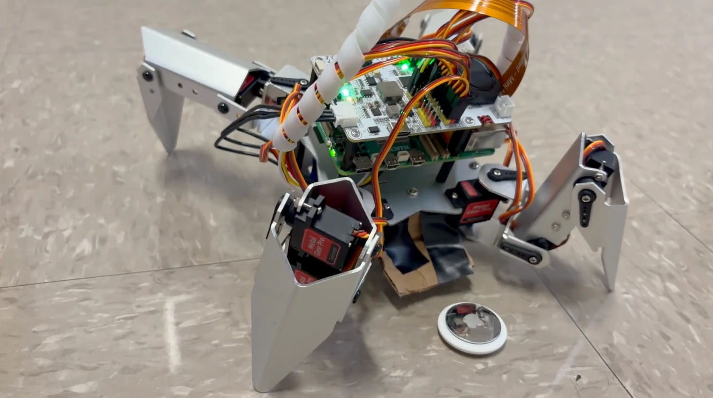<br>
      <sub><b>The beacon.</b> prada marks where a survivor was found so responders can walk straight to them.</sub>
    </td>
  </tr>
</table>

## The operations console

The dashboard runs on a laptop on the same network. It shows every robot, mirrors what the visor wearer sees, and runs local floor and object detection on the camera feed.

<table>
  <tr>
    <td width="50%" align="center">
      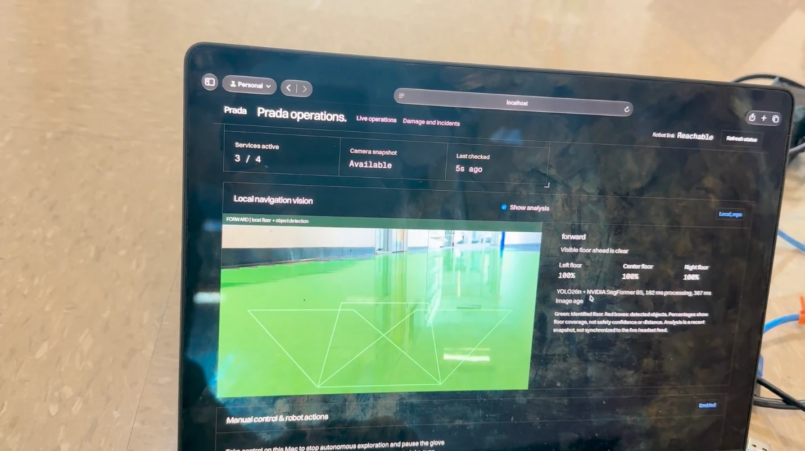<br>
      <sub><b>Local navigation vision.</b> YOLO26n and SegFormer mark open floor in green and objects in red.</sub>
    </td>
    <td width="50%" align="center">
      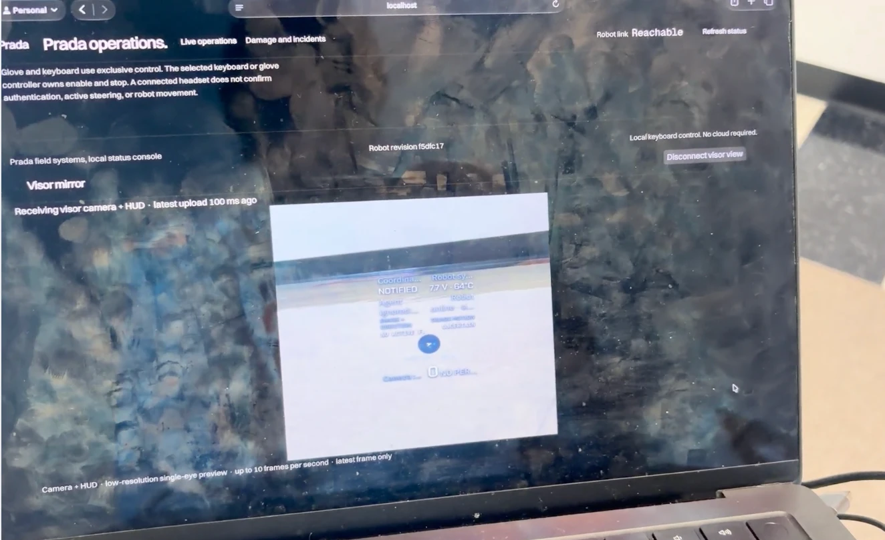<br>
      <sub><b>Visor mirror.</b> The console sees the same camera and HUD the rescuer sees.</sub>
    </td>
  </tr>
</table>

## Features

| Feature | What it does |
| --- | --- |
| **Direct robot feed** | Strap on the visor and see the robot's camera, then switch to the front camera to see the path ahead. |
| **Head-tracked camera** | Tilt and turn your head to aim the robot's view. |
| **Glove controller** | Joystick input drives the robot forward, backward, up, and down. |
| **Survivor segmentation** | The visor runs YOLO26n-seg through Core ML on the iPhone to mask people in the robot's view, with a fading radar showing where they are. |
| **Navigation vision** | The console runs YOLO26n and SegFormer on the camera feed to mark open floor and obstacles, so the robot can explore on its own. |
| **Nemotron scene reading** | Nemotron 3.5 Super VL reads camera frames to describe survivors and hazards for the agent. |
| **Survivor contact** | Speak through the robot to comfort someone and tell them help is on the way. |
| **Location beacon** | Drop a beacon where a survivor was found so responders can get there. |
| **Swarm search** | Send multiple robots across an impacted site instead of searching it by hand. |
| **Voice-directed Nemotron agent** | Give fleet commands out loud and keep working with the visor on. |
| **Critical-first queue** | The agent ranks survivors in critical condition and holds the rest in a queue. |

## How it works

### 1. Take over a robot

The rescuer straps on the visor, puts on the glove, and drives the robot that found someone.

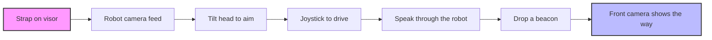

### 2. Swarm search with the agent

Robots search on their own. The rescuer talks to Nemotron and steps in when someone is critical.

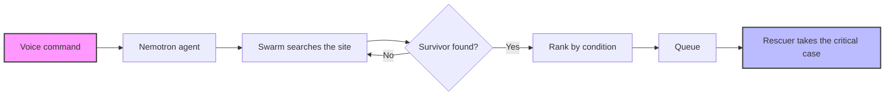

## Tech stack

### Robot and visor


- **Robot**: PiCrawler on a Raspberry Pi 5, Python control server, MJPEG camera, and onboard speech
- **Visor**: SwiftUI and Metal on iPhone, YOLO26n-seg person masks, head-tracked steering
- **Controller**: Glove with a joystick for forward, backward, up, and down

### Coordination


- **Agent**: Node.js 22 and TypeScript. Coordinator, triage, and search agents call tools against the robot and shared state.
- **Models**: Nemotron 3 Ultra plans. Lightning triages. Bolt searches. Nemotron 3.5 Super VL reads each camera frame.
- **State**: SpacetimeDB holds the shared record. Video, drive commands, and emergency stop stay on the local network and never go through the database.

## Project structure

| Folder | What's inside |
| --- | --- |
| [`agent/`](agent) | Nemotron mission team. A coordinator delegates to triage and search agents, reads camera frames, and writes shared state. |
| [`server/`](server) | SpacetimeDB module for robots, coverage, survivor cases, takeover requests, hazards, and incident evidence. |
| [`dashboard/`](dashboard) | LAN console for robot status, keyboard or USB-glove control, the visor mirror, and damage incidents. |
| [`headset/ios/`](headset/ios) | Native Swift visor. Stereo robot video, person segmentation, head steering, and voice commands. |
| [`robot/`](robot) | PiCrawler control, camera stream, speech, and the prada deployment. |
| [`hardware/`](hardware) | 3D-printed headset shells, lens carriage, and strap adjusters. |
| [`scripts/`](scripts) | Local stack that starts SpacetimeDB, the dashboard, and the agent together. |
| [`docs/`](docs) | Architecture, agent contracts, and the SpacetimeDB schema. |

## Getting started

### Prerequisites

- Node.js 22 or newer
- Python 3.11 or newer
- Xcode, to run the iPhone visor
- An NVIDIA API key, only if you want live Nemotron instead of the offline planner

### Installation

1. **Clone the repository**
2. **Agent**
   ```bash
   cd agent
   npm install
   cp .env.example .env
   ```
3. **Robot control, on a laptop first**
   ```bash
   python3 -m venv robot/.venv
   robot/.venv/bin/python -m pip install -e ./robot
   ```

### Running the application

**Offline agent demo.** No API key and no robot. A simulated crawler walks a room.

```bash
cd agent
npm run demo
```

**Full local stack.** Starts SpacetimeDB, publishes the module, then starts the dashboard and the agent.

```bash
python3 scripts/local-stack.py start
```

- Operations: http://localhost:8090
- Damage and incidents: http://localhost:8090/damage
- Operator voice: http://localhost:8788/operator

```bash
python3 scripts/local-stack.py status
python3 scripts/local-stack.py stop
```

**Visor.** Open `headset/ios/Visor.xcodeproj`, pick your signing team and iPhone, and run. The phone and the robot need to be on the same network. The default camera address is `http://prada.local:8080/stream`.

## Configuration

Copy `agent/.env.example` to `agent/.env`. Every switch has an offline default.

| Variable | Offline default | Live |
| --- | --- | --- |
| `LLM_MODE` | `mock` | `nvidia`, with `NVIDIA_API_KEY` |
| `ROBOT_MODE` | `sim` | `prada` for the real camera and speaker |
| `STATE_MODE` | set to `spacetime` by the local stack | `memory` for tests with no database |
| `OPERATOR_VOICE` | `on` | feed on port 8788 for the visor |
| `SPEAKER_MODE` | `off` | `pi` so the robot speaks through its speaker |

`scripts/local-stack.py` writes the local SpacetimeDB address and service token into `agent/.env`. That token stays on the machine that runs the stack. The database listens on `127.0.0.1:3000` only.

> [!WARNING]
> Video and drive commands go directly between the Pi and the phone. Do not put the control port or the database on a public network.

More detail lives next to each part: [agent/README.md](agent/README.md), [server/README.md](server/README.md), [dashboard/README.md](dashboard/README.md), [headset/ios/README.md](headset/ios/README.md), and [robot/README.md](robot/README.md).

---

<div align="center">
<sub>Built at HackUTD 2026 by the Four Sight team.</sub>
</div>
