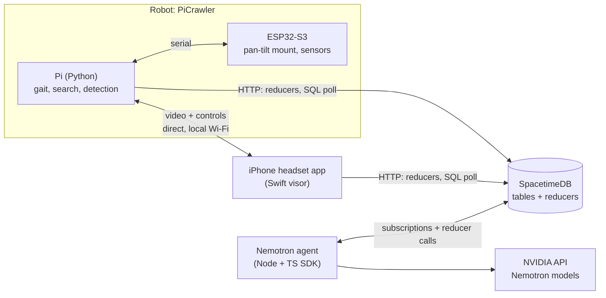

# Rescue Robot: HackUTD 2026 Plan

> Living plan for the team. Status tracker (dropdowns, owners): [HackUTD 2026: Rescue Robot Feature List](https://claude.ai/artifact/V7XnDqn5QrkXmuyj76c1gj)
> Last updated: Sat Nov 7, 2026 · Devpost registration **11 PM tonight** · Final submission **Sun noon** · Judging 1-4 PM

## Pitch

A $140 four-legged robot searches a collapsed building on its own. When it finds someone, it hands off to a human wearing a phone VR headset, who sees the person outlined, drives with a gamepad, and looks around by turning their head. A Nemotron agent runs the operation: it ranks takeover requests, assigns search areas, and sends responders, so **one operator can supervise many robots**.

**One-liner:** air traffic control for rescue robots.

**Why it matters vs. existing work:** VR-teleoperated rescue quadrupeds exist in research (Unitree + Quest, thousand-dollar setups). Ours runs on a $140 kit and the phone you already carry, so you can deploy dozens, and the agent-run takeover queue is what lets one human cover them all. Don't pitch it as "first ever"; pitch **cost + scale**.

## Tracks

| Track | What judges need to see | Our answer |
| --- | --- | --- |
| **State Farm**: The Worst Day, at Scale | Find the most urgent needs, coordinate help, make sure no one is overlooked | Robots search on their own; humans step in only when someone is found; coverage map shows what's unsearched; agent ranks cases and sends responders |
| **NVIDIA**: Nemotron beyond a chatbot | Multi-step agent, tool calls to real APIs, real-world problem | Nemotron reads robot images for triage, runs the takeover queue, assigns areas, dispatches; every tool call is logged by the agent |
| **Spacetime** (3rd company track, only if 3 are allowed) | Spacetime powers the core of the app, not just chat or movement; public GitHub repo | All shared state and coordination rules live in Spacetime: queue, atomic robot claiming, coverage, watchdog, simulated fleet |
| **Best Hardware** (general) | Custom hardware that's essential and works live | Head-tracked pan-tilt camera mount, drop sensor, beacon drop, custom 3D-printed headsets, on top of the PiCrawler kit |

- [ ] **Confirm the company-track limit with an organizer.** HackUTD's Devpost guide says max 2. If it's 2: submit State Farm + NVIDIA, and keep Spacetime as the backend anyway.
- Alternative 3rd track: Photon (agent texts/calls the operator and responders).
- Tracks can be changed until the noon deadline.

## Architecture



Rules:
- **Video and controls never go through Spacetime.** They go Pi ↔ iPhone directly over our own router or hotspot, because latency is everything in a headset.
- **Spacetime holds the shared state and the rules.** Robots, operators, cases, the queue, coverage. Everything else reads from it.
- **Use our own network,** not venue Wi-Fi.

## Repo layout (proposed)

```
robot/       Python on the Pi: gait, search, detection, video + control server, Spacetime HTTP client
mount/       ESP32-S3 firmware: pan-tilt servos, drop sensor, beacon latch
headset/     Swift visor: stereo view of the robot camera. Open headset/ios/Visor.xcodeproj
server/      SpacetimeDB module (TypeScript)
agent/       Node agent: Spacetime TypeScript SDK + Nemotron
hardware/    headset print files, mount brackets, wiring notes
docs/        plan.md
```

## Areas and owners

| Area | Owns | Owner |
| --- | --- | --- |
| Robot | `robot/`: autonomy, detection, video + control server | _TBD_ |
| Headset | `headset/ios`: Swift visor | _TBD_ |
| Agent | `server/`, `agent/` | _TBD_ |
| Hardware | `mount/`, `hardware/`, demo set | _TBD_ |

## Interfaces (agree on these first)

Everything below is a **proposal**; change it, but change it here so everyone builds against the same contract.

### Robot ↔ headset (direct, local Wi-Fi)

- **Video:** Pi serves MJPEG over HTTP on `stream_port` (8080). `GET /stream` is `multipart/x-mixed-replace; boundary=frame`, one JPEG per part (`Content-Type: image/jpeg` and `Content-Length`). `GET /frame` is the latest JPEG once. The Swift visor opens `http://<pi>:8080/stream` and shows that picture in both eyes. Until the camera is connected, `python -m picrawler_control.stream` sends a test picture; the camera later calls `FrameBuffer.publish` with JPEG bytes and the HTTP shape stays the same. Target: under ~200 ms. Move to WebRTC only if MJPEG is too late.
- **Control:** WebSocket server on the Pi, JSON messages.

Phone → Pi:
```json
{"type": "drive", "forward": 0.6, "turn": -0.2}
{"type": "look", "pan": -35, "tilt": 10}
{"type": "mode", "mode": "manual"}
{"type": "release"}
```

Pi → phone:
```json
{"type": "status", "mode": "waiting", "battery": 0.72}
{"type": "person", "bearing_deg": -40, "distance_m": 2.1, "box": [0.31, 0.42, 0.18, 0.36]}
```

- **Head tracking:** phone sends `look` from its motion sensors. The mount handles pan/tilt; when head yaw goes past the mount's range, the Pi turns the body to follow.
- **Two-way voice (P1):** phone mic → Pi speaker, Pi mic → phone. Simplest version: push-to-talk clips over the same WebSocket.

### Pi ↔ ESP32-S3 (serial)

```
Pi → ESP32:  P<pan_deg> T<tilt_deg>\n        e.g. P-35 T10
ESP32 → Pi:  D<drop_cm> H<heat>\n             sensor readings, ~10 Hz
```

Note: the Robot HAT's 12 servo ports are all used by the legs, which is why the ESP32 drives the mount.

### SpacetimeDB module (`server/`, TypeScript)

Setup: `spacetime init --lang typescript`, `spacetime publish`. Use code `HACKUTD2026` (leaflet QR) for Maincloud credit. Fallback if venue internet is flaky: `spacetime start` on a laptop on our router.

**Tables**

| Table | Key fields | Written by |
| --- | --- | --- |
| `robot` | id, name, mode (searching / waiting / manual / returning / offline), x, y, heading, battery, area_id, operator_id, last_seen, simulated | `robot_checkin`, `claim_robot`, `release_robot`, watchdog |
| `area` | id, bounds, status (unsearched / assigned / searched), robot_id | `assign_area`, watchdog |
| `coverage_cell` | x, y, searched_by, searched_at | `robot_checkin` |
| `case` | id, robot_id, x, y, snapshot_url, triage (red / yellow / green / black), description, status (found / viewing / responders_sent), responder_team | `report_detection`, `set_triage`, `dispatch_responders` |
| `takeover_request` | id, case_id, robot_id, priority, reason, status (waiting / claimed / done), operator_id | `report_detection`, `set_priority`, `claim_robot` |
| `operator` | identity, name, robot_id | `claim_robot`, `release_robot` |
| `responder_team` | id, name, x, y, status | seed data, `dispatch_responders` |
| `agent_log` | id, time, tool, args, result | every agent reducer |

**Reducers (server functions)**

| Reducer | Called by | Does |
| --- | --- | --- |
| `robot_checkin(robot_id, x, y, heading, battery, mode)` | Pi, a few times/sec | Updates the robot; marks the cells it can see as searched |
| `report_detection(robot_id, x, y, confidence, snapshot_url)` | Pi | Ignores duplicates of an open case nearby; else creates a case + takeover request; robot → waiting |
| `claim_robot()` | Headset | Atomically claims the top waiting request (two operators can never grab the same robot); robot → manual |
| `release_robot(robot_id)` | Headset | Robot → searching; request → done |
| `set_triage(case_id, color, description)` | Agent | Fills the triage card |
| `set_priority(request_id, priority, reason)` | Agent | Re-ranks the queue |
| `assign_area(robot_id, area_id)` | Agent | Sends a robot to an unsearched area |
| `dispatch_responders(case_id, team_id)` | Agent | Marks a team en route to a case |
| `watchdog` (scheduled, ~1 s) | Spacetime | Robot silent for a few seconds → offline; its area goes back to unsearched |
| `sim_tick` (scheduled) | Spacetime | Moves simulated robots; occasional simulated detections |

**Calling it from Python (Pi) and the headset:** there's no SDK for either, so use the HTTP API:

```
POST /v1/identity                               → {"identity": "...", "token": "..."}
POST /v1/database/<db>/call/<reducer>           body: JSON array of args
POST /v1/database/<db>/sql                      body: SQL text → rows as JSON
Header: Authorization: Bearer <token>
```

Poll every ~0.5 s for orders (Pi) and the triage card (headset). The agent uses the TypeScript SDK and gets live updates.

### Nemotron (`agent/`)

- **Vision:** a Nemotron vision model on build.nvidia.com (e.g. Nemotron Nano 12B v2 VL for speed, or Nemotron 3.5 Super VL). OpenAI-compatible API.
- **Agent loop:** a Nemotron model with tool calling. Tools = `set_triage`, `set_priority`, `assign_area`, `dispatch_responders`, plus read-only `get_state` from the subscription cache. Every call writes `agent_log`.
- **Triggers:**
  - New case → describe the snapshot → `set_triage` → re-rank the queue.
  - Robot finishes its area → `assign_area` to the nearest unsearched area.
  - Red triage → `dispatch_responders` with the nearest free team.
- **First hour:** confirm which model IDs support tool calling on the hosted API. Fallback: ask for strict JSON and run the tool ourselves.

## Features

Status lives in the [tracker doc](https://claude.ai/artifact/V7XnDqn5QrkXmuyj76c1gj); this is the checklist version.

### P0: the core loop (must work by 11 PM)

- [ ] **Robot bring-up** (Robot): Pi boots, servos calibrated, a laptop script walks/turns/stops it over Wi-Fi
- [ ] **Live video to the iPhone** (Robot, Headset): Cam 3 feed in the app over our hotspot, under ~200 ms
- [ ] **Autonomous search** (Robot): search pattern, ultrasonic obstacle avoidance, stop every couple of meters for a 360° sweep
- [ ] **Person detection on the Pi** (Robot): lightweight detector flags a person during a sweep; robot stops
- [ ] **Handoff** (Robot, Headset): robot switches to manual; headset shows "Person found"
- [ ] **Headset view** (Headset): full-screen side-by-side, same image in both eyes
- [ ] **Person outline** (Headset): Apple Vision `VNGeneratePersonInstanceMaskRequest` over the live view; Pi's box as fallback
- [ ] **Joystick driving** (Headset): Bluetooth gamepad paired to the iPhone walks and turns the robot
- [ ] **Head-tracked camera mount** (Hardware, Headset): ESP32-S3 pan-tilt from phone motion; body follows past the mount's range
- [ ] **Nemotron triage card** (Agent): on handoff, frame → Nemotron vision → description + triage color in the headset

### P1: after the core loop works (start the agent early)

- [ ] **Spacetime module** (Agent): tables + reducers above, deployed
- [ ] **Nemotron agent with tools** (Agent): queue ranking, area assignment, dispatch; tool trace in the agent log
- [ ] **Coverage map** (Agent): searched / unsearched / person-found cells and a "% searched" number; agent sends robots to gaps
- [ ] **Arrow to the person** (Headset): edge-of-screen arrow + distance when the person is out of view
- [ ] **Mini map in the headset** (Headset): robot's path and the person's position
- [ ] **Two-way voice** (Robot, Headset): talk through the robot's speaker; hear through its mic
- [ ] **Failsafes** (Robot): won't walk into obstacles in manual mode; walks back along its path on Wi-Fi loss or low battery
- [ ] **Drop sensor** (Hardware): downward IR distance sensor at the front stops it at holes, stairs, table edges

### P2: stretch (only if ahead)

- [ ] **Simulated fleet** (Agent): `sim_tick` robots search their own areas; one operator covers many
- [ ] **Robot asks triage questions** (Agent, Robot): asks aloud, records answers, Nemotron judges responsiveness
- [ ] **Listen for help** (Robot): turns toward a voice or knocking
- [ ] **Beacon drop** (Hardware): ESP32-S3 puck on a servo latch drops beside the person; blinks, beeps, broadcasts Bluetooth
- [ ] **Haptic controller** (Hardware): ESP32-S3 + joystick + vibration motor that buzzes faster near the person
- [ ] **Heat sensor overlay** (Hardware, Headset): thermal array or IR thermometer on the mount
- [ ] **Second operator** (Headset, Agent): two headsets claim different robots at once

## Hardware

| Part | Job | Have it? |
| --- | --- | --- |
| SunFounder PiCrawler kit | The robot: 12 leg servos, ultrasonic sensor, Robot HAT with speaker | Have |
| Raspberry Pi 4 or 5 | Runs the robot (kit doesn't include one; Zero 2W is too slow for detection) | **Check** |
| Pi Camera Module 3 | Main camera on the pan-tilt mount | Have |
| 2 small servos + pan-tilt bracket | Camera mount | **Need** |
| ESP32-S3 dev kits | Mount driver, sensors, beacon, controller | Have |
| Robot batteries + charging supply | Robot HAT v4 charges the compatible kit battery pack through its USB-C port using a 5V/2A supply; bring spares | **Check** |
| iPhone 16 Pro / Pro Max | Headset display, motion sensors, person mask | Have |
| 3D-printed Flow VR viewers | Headsets | Have |
| Bluetooth gamepad | Joystick driving | **Check** |
| IR distance sensor (e.g. Sharp GP2Y0A21) | Drop sensor, pointing down at the front | **Check** |
| Thermal array or IR thermometer | Heat overlay (stretch) | **Check** |
| USB mic (if the kit has none) | Two-way voice | **Check** |
| Arduino Uno Q | Optional base-station box; skip if short on time | Have |
| Wi-Fi router or phone hotspot | Private network for video | **Check** |
| Meta Quest (hardware lab, request on Harp) | Backup headset | **Check** |
| Cardboard, blanket, doll + hand warmer | Demo set (hand warmer gives heat sensors something to find) | **Need** |

Robot HAT v4 charging: connect the supply to the **HAT USB-C port**, not the Pi's USB-C port. The red CHG indicator lights while charging and turns off when full; the HAT power switch need not be on. See [HAT v4 indicators](https://docs.sunfounder.com/projects/robot-hat-v4/en/stable/hardware_introduction.html) and the [PiCrawler charging FAQ](https://docs.sunfounder.com/projects/pi-crawler/en/latest/faq.html). Battery and charging-supply availability still need checking.

## Timeline

| When | Phase | Done when |
| --- | --- | --- |
| 5-7 PM | Bring-up | Robot walks on command, video reaches the iPhone, API keys work |
| 7-11 PM | Core loop (P0) | Search → detect → hand off → outlined view, joystick, head tracking |
| **11 PM** | **Devpost registration due** | Team registered, every teammate invited, tracks picked |
| 11 PM-3 AM | Agent | Spacetime module, Nemotron tools, queue |
| 3-7 AM | P1 polish | Coverage map, arrow, voice, failsafes, drop sensor |
| 7-10 AM | Stretch + rehearsal | Pick P2 items, build the set, record backup video |
| 10 AM-noon | Submit | Write-up, public repo, video; tracks final |
| **Noon** | **Final deadline** | Everything submitted |
| 1-4 PM | Judging | Batteries charged, set built |

If the core loop slips past 11 PM, cut P1 items before cutting the agent: the NVIDIA track depends on it.

## Demo script (~3 minutes)

1. Robot starts in autonomous mode in the collapsed-room set and searches; the agent tracks coverage as "% searched" climbs.
2. It sweeps, spots the person, stops; a takeover request lands in the queue with Nemotron's triage card.
3. A judge puts on the headset: person outlined, drive with the gamepad, look around by turning their head.
4. Operator talks to the person through the robot's speaker.
5. Agent creates the case, pins it on the map, sends responders; the agent log shows each tool call.
6. Close on scale: $140 robots, one operator, many robots. No one left unchecked.

## Submission checklist

- [ ] Team registered on Devpost by 11 PM, every teammate invited
- [ ] Tracks picked (changeable until noon)
- [ ] **Public** GitHub repo linked (required for Spacetime; private repos risk disqualification)
- [ ] Backup demo video recorded
- [ ] Write-up: what's real vs. simulated, which Nemotron models
- [ ] Final submit before noon
- [ ] Batteries charged, set built before 1 PM

## Open questions

- [ ] Company-track limit: 2 or 3?
- [ ] Do we have a Raspberry Pi 4 or 5?
- [ ] Is the PiCrawler assembled and calibrated?
- [ ] Exact sensors we have (thermal? IR distance? PIR? mic?)
- [ ] Where do the 2 mount servos come from?
- [ ] Does Devpost list a Niantic Spatial challenge that fits the headset?
- [ ] Demo victim: doll + hand warmer, or a teammate?
- [ ] Owners for each area

## Risks and fallbacks

| Risk | Fallback |
| --- | --- |
| Gait unreliable on uneven ground | Flat demo set; slower gait; keep manual driving as the safe path |
| Video latency too high | Drop resolution/fps; MJPEG → WebRTC; demo on the phone screen without the headset |
| Apple mask fails on a covered person | Pi detector's box; Nemotron description still shows |
| Nemotron tool calling flaky | Strict JSON output + our own dispatcher; retries; cache last result |
| Venue internet down | Local `spacetime start`; phone hotspot for Nemotron |
| Only 2 company tracks allowed | State Farm + NVIDIA; Spacetime stays as the backend |
| Live demo fails at judging | Backup video, recorded by 10 AM |

## References

- [HackUTD Devpost guide](https://hackutd-tech-guide-git-springbranchupdated-acmutd.vercel.app/dayof/devpost)
- [SpacetimeDB HTTP API](https://spacetimedb.com/docs/1.12.0/http/database) · [Schedule tables](https://spacetimedb.com/docs/tables/schedule-tables) · [Client SDKs](https://spacetimedb.com/docs/intro/language-support)
- [Nemotron models on build.nvidia.com](https://build.nvidia.com/search/models?q=nemotron)
- [PiCrawler docs](https://docs.sunfounder.com/projects/pi-crawler/en/latest/)
- [Apple Vision: VNGeneratePersonInstanceMaskRequest](https://developer.apple.com/documentation/vision/vngeneratepersoninstancemaskrequest)
